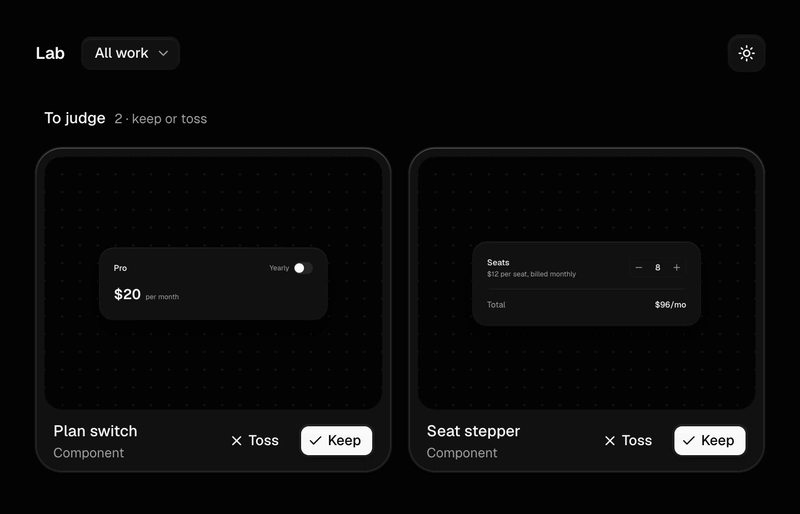
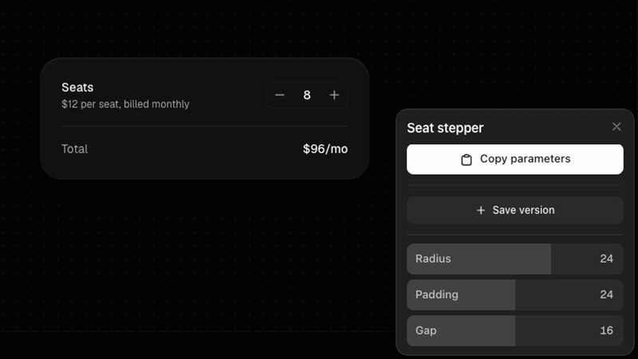

# byolab

Build your own lab. A place to build UI components with your coding agent, judge them by hand, and render them as frame-exact films or save them for later.

- **Gallery** of everything you've made, with drafts waiting for a keep or toss.
- **Workbench** for each component, with an anatomy view (skeleton and live measurements) for layout breakdowns.
- **Films** that drive the real component, not a recording: a storyboard of clicks and tweens, rendered frame by frame to mp4 in light and dark.
- **Taste that compounds.** Every toss asks why, and the reason becomes a rule your agent reads next time.
- **DialKit built in.** Tune a spring or a radius by hand in the workbench, then hand the numbers back to your agent.

This is a blank canvas. It starts from my opinions (a grid, a theme, a few taste rules) so it works out of the box, but it's meant to become yours. No skill gives you taste. You are the skill.

## Start

Make your own copy (**Use this template** on GitHub, or clone it), open it with your agent, and ask:

> what do I do?

It checks your setup, starts the lab, and walks you through your first component. Or do it by hand:

```bash
pnpm install
pnpm exec playwright install chromium   # for rendering
pnpm dev                                # http://localhost:5420
```

Rendering needs `ffmpeg` on your PATH.

Then ask your agent for something:

> Make a copy button that shows what it copied.

The agent reads `AGENTS.md`, scaffolds a draft with `pnpm lab new`, builds it, and sends you the link. Try it in the gallery, then keep it or toss it with a reason.



See [Judging work](docs/judging.md) for how keep and toss work, and how to write notes that make the next draft better.

## Commands

Every command is built for agents first: plain arguments, clear errors, and `--json` output.

```bash
pnpm lab new <slug> [--kind component|explainer|breakdown] [--name ".."] [--idea ".."] [--size 480x320]
pnpm lab list
pnpm lab keep <slug>
pnpm lab toss <slug> --reason "spacing is too loose"
pnpm lab grid <slug>                      # spacing, radius, and type limits from GRID.md
pnpm lab check <film>                     # film is frame-exact
pnpm lab still <film> <seconds>
pnpm lab render <film> [--theme light|dark] [--height 2160] [--no-sound]
pnpm lab export <film> [--theme both]     # → exports/<film>/
```

## Kinds

| Kind | What it is |
| --- | --- |
| `component` | One component with one interaction worth trying and watching. |
| `explainer` | One instance plays the same input with a detail off, then on, and the hidden mechanism is drawn in. Full bleed, portrait. |
| `breakdown` | How the parts of a layout relate, with a skeleton, guides, and live measurements. |

## Tuning with DialKit

[DialKit](https://github.com/joshpuckett/dialkit) by [@joshpuckett](https://x.com/joshpuckett) is wired into the workbench, and the component starter already uses it:

```tsx
const dial = useDialKit('Seat stepper', {
  radius: [24, 8, 32, 8],
  fill: { type: 'spring', visualDuration: 0.4, bounce: 0.2 },
})
```



Open the component at `#/s/<slug>`, drag the controls in the panel, then press **Copy** and paste the values to your agent. It bakes them into the component as plain constants. The panel only shows in `pnpm dev`, and films use the baked values, so renders stay exact.

## Updating

byolab ships releases as tags (`v0.1.0`, ...) with notes in [CHANGELOG.md](CHANGELOG.md). To pull one into your lab, ask your agent:

> update my lab

It fetches the new release, tells you what changed, and patches the engine on a branch. Your taste, ledger, theme, and components are left alone.

## Make it yours

Ask your agent to change any of it. A few places to start:

- **Bring your skills.** Add your favorite UI skills to `.agents/skills/`, and your agent uses them when it builds.
- **Use your components.** Tell it to build on a certain [shadcn](https://ui.shadcn.com) component or theme, or your own design system.
- **Set your grid.** The lab starts from a grid, an idea from [@MSchwaibold](https://x.com/MSchwaibold). Tune `GRID.md`, or ask your agent to fit it to your aesthetic.
- **Test other viewports.** Ask your agent to add [knobs](https://knobs.dev) by [@mertduzgun](https://x.com/mertduzgun) to try devices, locales, and times.

The files that hold it all:

- **`TASTE.md`** is your rules. It starts with sensible defaults; replace them as you judge work.
- **`GRID.md`** sets the spacing, radius, and type limits that `pnpm lab grid` checks.
- **`src/index.css`** holds the theme tokens and elevation scale. Change the look there.
- **`.agents/skills/`** teaches your agent the workflows. Edit them like any other file.
- **`LEDGER.md`** appears after your first keep or toss and records every verdict.
- **`CHANGELOG.md`** is byolab's own release notes. Leave it as is so updates know where you're coming from.

## Layout

```
src/specimens/<slug>/   kept work: index.ts, <slug>.tsx, film.ts
src/drafts/<slug>/      drafts waiting to be judged
src/films/<slug>/       films that aren't tied to one component
src/film/               the film engine
src/lab/                the gallery and workbench
scripts/                the lab CLI and renderer
```

The lab ships empty. `pnpm lab new` writes a working starter for each kind, so your first draft is one command away.

## License

MIT
