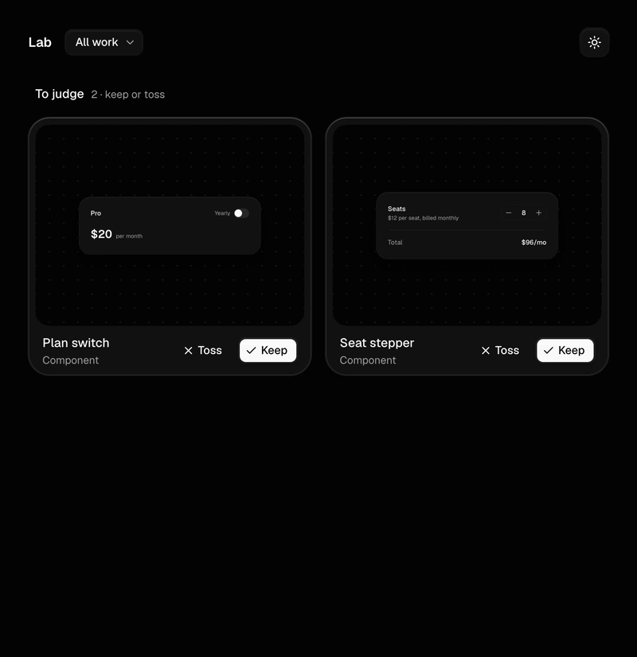
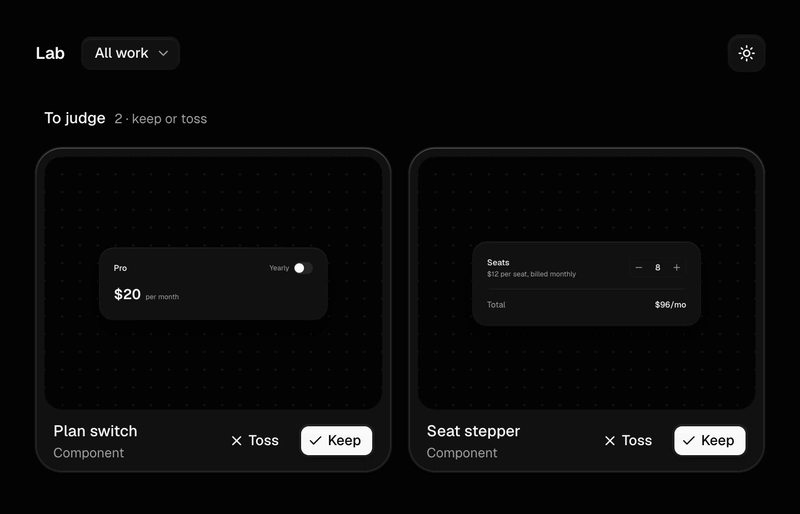

# Judging work

Every new component starts as a draft under **To judge** in the gallery. Open it, use it with your own hands, then keep it or toss it. Your agent never judges for you, because your judgment is the whole point of the lab.

## Keep

Keep it when you'd ship it as-is. It moves to `src/specimens`, joins **Kept**, and gets a line in `LEDGER.md`.



From the terminal, or when you ask your agent:

```bash
pnpm lab keep seat-stepper
```

## Toss

Toss it when it isn't right. The lab asks why, in one line. The draft moves to `out/tossed/` (you can still get it back), and your reason lands in `TASTE.md` under "Toss notes, not yet rules". Next time your agent proposes or builds anything, it reads that note and turns it into a rule.



```bash
pnpm lab toss plan-switch --reason "the switch is too small to find, and \$200 hides the saving"
```

## Write notes your agent can use

Your reason is the only thing that carries forward, so it decides whether the next draft gets better. A good note names **the part**, **what's wrong with it**, and, when you know, **what you'd rather see**.

| Instead of | Write |
| --- | --- |
| looks bad | spacing is too loose, it reads as a mockup |
| meh | familiar pattern, I've seen this toggle a hundred times |
| not practical | clever, but no product would ship a cancel button you drag |
| the button is off | the upgrade button floats in the header; put it next to the status it answers |
| too much | two ideas in one card, the forecast and the scrubber fight |
| wrong colors | the amber warning is too loud for a state that isn't urgent yet |

A few habits that pay off:

- **One note, one problem.** Two problems are fine in one line, but split them with "and" so each can become its own rule.
- **Say it the way you'd say it out loud.** The agent keeps your words. Casual is fine; vague isn't.
- **Name what you'd keep.** "Love the receipt, hate the timer bar" saves the good half next time.
- **Notes outside a toss count too.** When you tell your agent "the cursor is too slow" mid-build, it fixes it and adds a rule to `TASTE.md`.

## Where it all goes

| File | What's in it |
| --- | --- |
| `LEDGER.md` | Every keep and toss, with the date and the idea. Your agent reads it to stop repeating tossed ideas. |
| `TASTE.md` | Your rules. Toss notes collect at the bottom until your agent turns them into rules with reasons. |
| `out/tossed/` | Tossed drafts, untracked. Move a folder back into `src/drafts/` to revive it. |
